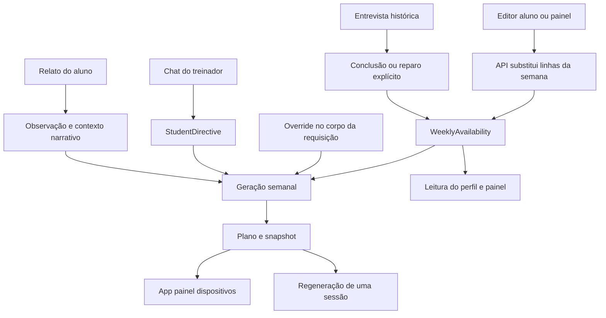

# Auditoria da rotina dos alunos — checkout canônico Panzeri Run

Data: 26/10/2026. Revisão 2: investigação refeita no checkout canônico. Etapa: diagnóstico, sem correção de produto.

Esta revisão substitui o relatório anterior. Todas as buscas e execuções desta rodada partiram de `C:\Users\elton\OneDrive\Documentos\GitHub\panzeri-run-api`. A pasta antiga não compõe o inventário, as referências de código ou a base de testes desta revisão.

## Conclusões e limites da evidência

Há caminhos independentes capazes de produzir o problema descrito. Um relato textual pode ser salvo sem alterar a disponibilidade; uma escrita atrasada pode substituir a semana mais recente; o reparo administrativo pode reconstruir a rotina a partir da entrevista histórica; e uma prescrição pode continuar usando dias anteriores mesmo quando a disponibilidade está correta. Portanto, “a rotina voltou” precisa ser investigado em três lugares: disponibilidade persistida, estado exibido e planejamento materializado.

O armazenamento operacional pretendido é `WeeklyAvailability`. Ele não constitui, hoje, uma autoridade respeitada por todos os fluxos: não há revisão da semana, proteção contra atualização obsoleta ou uma operação única de alteração. Além disso, overrides, diretrizes e sessões antigas podem prevalecer na prescrição sem alterar essa tabela.

Foram executados **21 casos de investigação com trechos reais extraídos por AST**, com persistência, notificações e IA simuladas. As 21 verificações passaram: várias confirmam comportamentos defeituosos, não aprovação do produto. Não houve conexão ao banco, chamada ao modelo, alteração de aluno, deploy ou mudança de código funcional.

A referência exclusiva é `C:\Users\elton\OneDrive\Documentos\GitHub\panzeri-run-api`, HEAD `02bf6d2`. Foram conferidos novamente rotas, importações dos módulos, escritores, leitores, modelos, validação, painel, mobile, geração, regeneração e scheduler. Os hashes dos fontes executados estão em `resultados.json`; a nova execução está em `execucao-canonica.json`. Os cinco testes existentes de disponibilidade também passaram em duas suítes Jest, executadas a partir de `apps/api`.

**Limitação essencial:** não foi identificada a imagem efetivamente implantada, a versão instalada nos aparelhos ou a escrita responsável por um incidente real. “Acessível no código” não significa “execução comprovada em produção”. A atribuição de um incidente específico permanece pendente de correlação com versão e registros operacionais. Não seria correto afirmar que todos os caminhos abaixo já ocorreram com alunos reais.

## A. Inventário completo do material encontrado

O inventário pesquisável está em [inventario.csv](./inventario.csv), com versão detalhada em [inventario.json](./inventario.json): **339 arquivos candidatos exclusivamente deste repositório**. Inclui caminho, categoria, linhas encontradas, quantidade de ocorrências e SHA-256. A busca foi ampliada para termos de horários, frequência, restrições, planejamento e programação. Ocorrência lexical não comprova uso; arquivos gerados e cópias aparecem separadamente. Dependências, binários, segredos e configurações privadas foram excluídos. Essa é a cobertura dos arquivos disponíveis, não uma certificação de componentes externos não presentes nessas árvores.

### Componentes e situação de execução

Os caminhos abaixo são relativos ao checkout canônico citado acima. “Acessível” significa rota, chamada ou importação encontrada; o uso em produção não foi confirmado.

| Arquivo ou conjunto | Papel | Situação demonstrada |
|---|---|---|
| `apps/api/prisma/schema.prisma` | WeeklyAvailability, User, entrevista, diretrizes, perfil, planos e snapshots | Modelos atuais; banco implantado não inspecionado |
| `apps/api/prisma/migrations/**` | Criação da disponibilidade, duração por modalidade, data de mudança e nota de divergência | Histórico de estrutura; aplicação em produção não verificada |
| `apps/api/src/me/me.controller.ts` | Rotas do aluno para disponibilidade, anamnese, respostas e conclusão da rotina | Acessível com autenticação |
| `apps/api/src/me/me.service.ts` | Leitura, substituição, conversão da entrevista e encaminhamento de observações | Escritor operacional atual |
| `apps/api/src/me/dto/update-availability.dto.ts` | Contrato de entrada | Usado pelas rotas atuais |
| `apps/api/src/me/availability.rules.ts` | Validação de negócio | Usado por aluno e treinador |
| `apps/api/src/coach/coach.controller.ts` | Edição e reparo da disponibilidade | Acessível a treinador/admin |
| `apps/api/src/coach/coach.service.ts` | Edição, reparo, detalhe do aluno e mesclagem de contas | Leitor e escritor operacional |
| `apps/api/src/coach/coach-tooling.controller.ts` | Ferramentas para consulta administrativa | Não encontrado comando de alteração da rotina nesse controlador |
| `apps/api/src/technical-manager/technical-manager.controller.ts` | Chat do Gerente Técnico | Restrito a treinador/admin; não é chat geral do aluno |
| `apps/api/src/technical-manager/technical-manager-agent.service.ts` | Prompt, histórico, contexto e ferramentas do chat | Acessível; ferramentas não atualizam WeeklyAvailability |
| `apps/api/src/observations/observations.service.ts` | Recebimento de relato do aluno | Salva observação; não altera dias |
| Serviços de ReportTimeline, StudentReporter e StudentProfile | Análise de relatos, eventos e resumo longitudinal | Contexto narrativo; sem escritor direto de WeeklyAvailability encontrado |
| `student-information-context.ts` | Seleção de registros persistentes, recentes e resolvidos para contexto | Leitura narrativa, não autoridade da rotina |
| `apps/api/src/training-plans/training-plans.controller.ts` | Geração semanal, regeneração e operações em sessões | Acessível; geração ainda aceita disponibilidade no corpo |
| `apps/api/src/training-plans/training-plans.service.ts` | Seleção da rotina, geração, snapshots, freshness e regeneração | Consumidor operacional; não atualiza a rotina ao gerar |
| `apps/api/src/training-plans/prescription-agent.service.ts` | Prompts e validação de sessões | Consumidor; aceita divergências em situações descritas adiante |
| `apps/api/src/training-plans/training-methodology.ts` | Cálculo de slots e duração | Consumidor derivado |
| `apps/api/src/training-plans/weekly-plan-scheduler.service.ts` | Geração coletiva/manual | Geração automática semanal sem `@Cron` no código atual; método manual permanece |
| Serviços de check-in e provas-alvo | Verificação de disponibilidade e contexto | Leitores; nenhum escritor direto de rotina encontrado |
| Integrações de entrega para dispositivos | Exportação de sessões prescritas | Consomem o planejamento, não corrigem a disponibilidade |
| `apps/api/src/app-review/review-accounts.ts` | Inicialização/recriação de contas de demonstração | Escritor explícito restrito a contas de revisão |
| Scheduler de contas de revisão | Avanço do conteúdo demonstrativo | Não confundir refresh periódico com recriação da disponibilidade |
| `backup/backup-restore.ts` | Restauração do banco | Caminho operacional explícito; não executado nesta auditoria |
| Serviços de exclusão de conta | Remoção de dados | Podem apagar disponibilidade; não restauram rotina antiga |
| `apps/mobile/App.tsx` | Aplicativo do aluno: entrevista, editor, perfil, conversão e estado local | Caminhos ligados à interface atual |
| `apps/admin/app/page.tsx` | Painel: detalhe, editor administrativo, reparo e exibição histórica | Chamadas às rotas administrativas encontradas |
| `apps/mobile/src/appUpdate/{useAppUpdate,bundleName}.ts` | Detecção de nova versão do bundle web | Mitiga JS antigo em memória; não sincroniza a rotina de uma tela com alterações administrativas |
| `apps/api/src/messaging/notification-triggers.service.ts` | Verifica existência de rotina para mensagens de acompanhamento | Leitor, não escritor da semana |
| `apps/api/src/training-intelligence/{athlete-state-snapshot.service,compact-agent-context}.ts` | Contexto de inteligência e disponibilidade de dados por domínio | `availability` também significa cobertura de dados; não assumir que toda ocorrência é agenda de treino |
| `apps/mobile/public/sw.js` | Cache do shell web | Rede primeiro; não encontrado cache explícito das respostas de rotina |
| `AJUSTE_ROTINA_ENTREVISTA_E_RELATOS.md`, `ORDEM_CLAUDE_IMPLEMENTACAO_ROTINA_CANONICA.md` | Intenção arquitetural e correções anteriores | Documentação; não comprova execução |
| `apps/api/dist/**` | Código compilado presente neste checkout | Executável pelo script de produção; versão em execução no servidor não confirmada |
| Testes, mocks e sementes listados no inventário | Construção de cenários | Desenvolvimento; não evidência de escrita em aluno real |

O Dockerfile normal compila `src`; a presença de uma cópia antiga em disco não prova que ela atende requisições. Por outro lado, sem conferir o processo/imagem implantado, também não é correto declarar todas as distribuições antigas inofensivas.

### Representações da rotina

| Representação / armazenamento | Criador e modificadores | Leitores / atualização | Natureza e conflitos |
|---|---|---|---|
| `WeeklyAvailability`, uma linha por usuário/dia | Aluno, treinador, sincronização da entrevista, mesclagem e seed de revisão | Perfil, painel, contexto, prescrição; substituição por requisição | Rotina operacional atual pretendida; múltiplos escritores sem revisão |
| Respostas JSON da entrevista | Onboarding, questionário e atualizações de respostas | Conversor de rotina, painel histórico e contextos sanitizados | Histórico declarativo; pode virar atual por reparo ou conclusão em casos específicos |
| `StudentDirective` | Ferramenta do chat do treinador | Prescritor e chat; ativa até expirar/desativar | Orientação textual; pode competir com os dias atuais na prescrição |
| `StudentObservation`, ReportTimeline e eventos de perfil | Relato e análise assíncrona | Contexto de prescrição e acompanhamento | Relato/histórico, não comando persistente de disponibilidade |
| `StudentProfile.summary` | Consolidação de eventos pelo serviço de perfil | Agentes e prescrição | Resumo narrativo que pode conservar informação antiga; não altera diretamente WeeklyAvailability |
| Histórico do Gerente Técnico | Mensagens e ferramentas | Até 40 mensagens recentes no contexto | Conversa passada, sem garantia de atualização do contexto a cada turno |
| `TrainingPlan.inputSnapshot` | Geração de plano | Auditoria/freshness | Histórico da geração; não deveria definir a rotina atual |
| Sessões e planos anteriores | Geração e operações em sessão | Histórico, tela, regeneração e integrações | Planejamento materializado; pode manter dias/durações anteriores |
| `weeklyOverride` recebido pela geração | Cliente que envia corpo com disponibilidade | Seleção de dias da geração | Prevalece sobre WeeklyAvailability; não é rotina persistida nem exceção com validade formal |
| `savedMe`, `anamneseRoutine` e estado dos editores | Leitura da API, hidratação e edição local | Telas do aluno e painel | Cópias transitórias; podem ficar antigas ou conter rascunho não salvo |
| Rotina padrão fixa | Código de fallback | Geração quando não há dias ativos | Outra base de planejamento: segunda/terça/quinta/sábado |
| Horários da entrevista (`*_available_time`) | Questionário histórico | Exibição histórica; removidos de contextos sanitizados | WeeklyAvailability armazena minutos, não faixas reais de horário |

`availability` e `weeklyAvailability` usados como alternativas na hidratação mobile não comprovam duas tabelas: são formas de ler o mesmo retorno. Frequência, dias de corrida e musculação derivam das linhas/modalidades, não de uma revisão global da semana. Não foi encontrado um agregado próprio de exceções de agenda com data inicial/final e precedência formal sobre a rotina recorrente.

## B. Mapa do fluxo atual



### Pedido “agora só posso terça, quinta e domingo”

1. No editor estruturado, o aplicativo monta a semana e envia `PUT /me/availability`. O backend valida, apaga as linhas anteriores e cria as recebidas dentro de transação; depois relê e devolve a disponibilidade.
2. Na área de observações, a mesma frase vira observação e contexto de análise. Não há nesse caminho uma operação de atualização dos dias. Registro recebido não equivale a rotina salva.
3. No chat administrativo, o agente pode salvar uma diretriz textual. Suas ferramentas não incluem alterar WeeklyAvailability. Não foi localizado um chat geral do aluno com ferramenta de alteração permanente nesse monorepo.
4. A API de disponibilidade retorna o estado salvo, mas o helper mobile usa principalmente `routineChanged/firstTime`; não verifica que a semana retornada corresponde integralmente à solicitada, nem transporta revisão.
5. Uma nova geração sem override consulta WeeklyAvailability. Uma geração com override usa o override; regenerar uma sessão usa a sessão antiga. Salvar disponibilidade não substitui automaticamente todos os treinos já entregues.
6. A escrita posterior de um editor antigo, uma anamnese com disponibilidade antiga ou um reparo da entrevista pode substituir a semana. Não há detecção de conflito por revisão.

### Leitores e garantias

| Leitor | Base e frescor | Pode receber informação antiga? |
|---|---|---|
| `MeService.availability` | Consulta direta às linhas atuais | Sem cache de serviço encontrado; resposta não possui revisão |
| Detalhe administrativo | Inclui disponibilidade atual | Tela aberta pode manter props/rascunho antigos |
| `gatherStudentContext` | Relê WeeklyAvailability ao executar a ferramenta | Sim, se ferramenta não for chamada; histórico anterior continua no chat |
| Geração semanal | Leitura inicial da disponibilidade ativa | Sim, override ou mudança durante geração demorada; sem validação final da revisão |
| Regeneração de sessão | Dia e duração da sessão existente | Sim, não consulta a rotina atual |
| Freshness | Comparação com snapshot | Snapshot marcado com override é aceito sem comparação da rotina |
| Aplicativo | Estado carregado e refresh em pontos específicos | Sim, mudança administrativa não é propagada automaticamente a toda tela aberta |
| Dispositivos | Sessão/plano exportado | Podem continuar exibindo programação anterior sem rollback da tabela |

## C. Fontes concorrentes e precedência

Há uma fonte operacional pretendida, mas não uma autoridade de ponta a ponta. A entrevista foi parcialmente isolada: a conclusão normal preserva uma disponibilidade existente com dias ativos, e a geração remove chaves históricas de rotina do questionário. Essas proteções são reais e passaram na investigação. Entretanto:

- O reparo administrativo pode forçar a reconstrução a partir da entrevista.
- Uma semana inteira em descanso não satisfaz a proteção `some(!noTraining)` e pode ser reconstruída pela conclusão da entrevista antiga.
- O override da geração tem precedência sobre a rotina atual, sem vínculo com revisão ou validade temporal.
- Diretrizes recebem prioridade elevada no prompt. A validação não transforma a disponibilidade em restrição obrigatória para todos os dias gerados.
- Regenerar uma sessão preserva sua base histórica; freshness pode considerar um plano com override atualizado mesmo divergindo da rotina.

Uma direção textual, uma preferência e uma restrição real não possuem a mesma semântica. Hoje essa diferença depende parcialmente da linguagem e dos prompts, não de um contrato verificável de atualização de agenda.

## D. Causas identificadas, com nível de evidência

As referências abaixo apontam para os fontes examinados. Os números são âncoras de leitura, não indicação de que cada linha isolada contém todo o fluxo.

### Comportamentos reproduzidos

| Achado | Evidência e consequência | Referência principal / teste |
|---|---|---|
| Pedido textual não é comando de rotina | Relato é salvo sem alterar WeeklyAvailability; o chat administrativo só tem ferramentas de contexto/diretriz | `observations.service.ts:25`; `technical-manager-agent.service.ts:216`; J, E1 |
| Escrita antiga substitui nova | Intercalação controlada: a requisição antiga termina depois e prevalece, sem conflito | `me.service.ts:691`; H, em memória, não PostgreSQL |
| Reparo reintroduz entrevista histórica | `force` restaura dias antigos por operação administrativa explícita | `me.service.ts:515`; `coach.service.ts:917`; G2 |
| Pausa completa não é protegida da entrevista | Sete dias sem treino são tratados como ausência de rotina ativa pelo guard | `me.service.ts:539`; G3 |
| Override antigo vence na geração | Dias enviados pelo cliente prevalecem, embora a tabela esteja correta | `training-plans.service.ts:875`; C2 |
| Ausência de dias ativos produz semana padrão | A seleção usa segunda/terça/quinta/sábado | `training-plans.service.ts:875`; C3 |
| Snapshot com override escapa da comparação | Freshness retorna compatível apesar de divergência | `training-plans.service.ts:3496`; C4 |
| Regeneração conserva base antiga | Sessão de segunda/60min é regenerada sem ler rotina atual de terça/quinta | `training-plans.service.ts:2040`; D |
| Payload parcial substitui a semana | Enviar um dia elimina os outros; o contrato atual é substituição | `me.service.ts:691`; I. Não é PATCH seguro |
| Validação insuficiente | Modalidade desconhecida e minutos negativos aceitos pelo validador de negócio | `availability.rules.ts:4`, DTO; I2 |
| Edição administrativa perde metadado | Dias são salvos sem atualizar `lastRoutineChangeAt` | `coach.service.ts:929`; K |
| Falha depois do commit gera resposta de erro | Encaminhar a observação falha após a gravação; rotina já mudou | `me.service.ts:611`, `691`; L2 |
| Conversão mobile é destrutiva para modalidade legada | `bike` hidrata como corrida e volta como corrida ao salvar | `apps/mobile/App.tsx:13539`; UI1 |

### Riscos estruturais demonstrados pelo código, sem reprodução integral

1. **Geração demorada:** o bloqueio de geração é próprio da geração, não das alterações de rotina. A rotina é lida no início; a transação que publica o plano não verifica sua revisão no final. Uma geração pode publicar a base anterior após uma alteração válida (`training-plans.service.ts:665`, `755`, `1475`). Isso não é uma escrita na tabela de rotina.
2. **Anamnese com payload antigo:** `updateAnamnese` ainda aceita disponibilidade opcional e a substitui integralmente. Um cliente legado pode reenviar uma semana obsoleta ao editar outros dados (`me.service.ts:750`). O mobile novo separa salvamentos em caminhos relevantes, mas a API permanece acessível.
3. **Dias extras aceitos:** a validação de prescrição admite divergências/avisos; decisões extras podem virar sessões fora da disponibilidade. A existência de qualquer diretriz ativa suprime certos avisos de divergência, mesmo sem verificar se autoriza aquele dia (`prescription-agent.service.ts:615`, `704`, `776`; `training-plans.service.ts:1203`, `1256`). Não foi executado o modelo para medir incidência.
4. **Confirmação sem alteração semântica:** a conclusão mobile trata `aborted`, mas não trata `preserved` como resultado distinto. Uma resposta preservando a rotina pode chegar à tela “Rotina salva” (`App.tsx:3225`, `3400`). Não foi reproduzido o fluxo visual completo.
5. **Estado antigo no editor:** o refresh antes de abrir o editor usa `finally`; falha de leitura ainda permite abrir com estado anterior. Uma resposta sem disponibilidade pode deixar o estado de edição anterior, e telas abertas não recebem atualização administrativa em tempo real (`apps/mobile/App.tsx:1587`, `1947`).
6. **Contexto incompleto:** `gatherStudentContext` usa `modalityDurations`, mas omite o fallback de `availableMin` usado pelo prescritor. Registros antigos podem aparecer sem minutos ao chat (`technical-manager-agent.service.ts:294`).
7. **Concorrência narrativa:** respostas de entrevista são atualizadas como JSON completo; resumos são derivados de resumo anterior/eventos. Sem revisão, processamento atrasado pode perder informação mais recente nesses objetos. Não foi demonstrado que esses resumos regravem WeeklyAvailability.
8. **Horário não representado:** minutos disponíveis não representam “só posso às 18h”. Não há campo operacional para faixa horária no modelo atual. Relato ou entrevista contendo horário não prova sua persistência na agenda.

### Hipóteses não confirmadas

Uso de imagem antiga em produção; cliente instalado antigo reenviando disponibilidade; algum reparo administrativo efetivamente disparado nos incidentes; sobrescrita PostgreSQL concorrente em aluno real; decisão específica do modelo priorizando memória; restauração operacional de backup; dispositivo exibindo plano antigo; falha de rede no aparelho. São caminhos a correlacionar, não causas já atribuídas aos relatos recebidos.

Não foi encontrado no fluxo atual um job automático genérico que restaure a rotina de todos a partir do onboarding. O código e as mensagens ainda contêm referências a geração automática de domingo, mas o scheduler atual não possui esse cron: a mensagem de sucesso mobile em `apps/mobile/App.tsx:13414` pode criar expectativa incorreta sobre quando o programa será atualizado. Salvar a rotina mantém os treinos entregues deliberadamente; isso é regra atual documentada, e não prova de falha de persistência. O scheduler de demonstração não deve ser acusado disso: o reset de disponibilidade pertence à inicialização explícita dessas contas.

## E. Mapa dos escritores e pontos de sobrescrita

| Escritor/caminho | O que modifica | Proteção e origem |
|---|---|---|
| `PUT /me/availability` | Apaga a semana e cria as linhas recebidas; atualiza data quando detecta mudança | Transação, sem revisão, ator/reason/evento de mudança durável |
| `PUT /me/anamnese`, com availability | Substitui semana junto com outros dados | Sem expectedRevision; payload opcional evita escrita quando ausente |
| Concluir rotina pela entrevista | Converte respostas e substitui semana | Preserva semana com dia ativo; pausa completa escapa dessa proteção |
| Reparo administrativo `sync-availability` | Reconstrói semana da entrevista | Preview padrão; aplicação forçada explicitamente; preview não vinculado à versão da aplicação |
| `PATCH` administrativo de disponibilidade | Substitui semana inteira apesar do nome PATCH | Sem revisão; não atualiza data de mudança da rotina |
| Mesclar aluno | Remove disponibilidade do destino e transfere a origem | Operação administrativa condicionada; não é atualização incremental |
| Seed de contas de revisão | Recria disponibilidade fixa de demonstração | Restrito por identidade/marcadores; não confundir com contas comuns |
| Restore de banco | Pode recolocar estado antigo do banco inteiro | Operação explícita; não executada nem observada em incidente |
| Migrações, seeds e testes | Estrutura ou dados de ambientes específicos | Execução em produção não presumida |
| Distribuições/cópias antigas | Contêm escritores de versões anteriores | Dependem do processo realmente iniciado; não há prova de atendimento atual |

`save_directive`, resumo de perfil, observação, check-in, geração e exportação de treino **não foram identificados como escritores diretos de WeeklyAvailability**. Eles podem mudar a interpretação ou o treino mostrado; isso deve ser separado de uma reversão persistida.

O helper legado `syncInterviewAnswersFromAvailability` permanece no fonte sem chamadores encontrados. Sua existência não comprova sincronização reversa em execução. Comentários sobre trava de 30 dias, sincronizações e geração automática não substituem a análise dos caminhos atuais.

### Banco e observabilidade

`WeeklyAvailability` tem unicidade por usuário/dia, timestamps por linha, modalidades, minutos e JSON de duração por modalidade (`schema.prisma:393`). Não há revisão da semana, histórico de antes/depois, ator, motivo ou identificador da solicitação. Apagar/recriar linhas limita a interpretação dos timestamps. `User.lastRoutineChangeAt` não cobre todos os escritores.

Os logs de comparação em serviços ocorrem antes da transação: mostram intenção, não comprovam commit. Logs com usuário e rotina inteira também merecem minimização. Notificações e eventos narrativos não substituem recibo transacional da alteração. A trilha de prescrição ajuda a explicar um plano, mas não identifica necessariamente quem sobrescreveu a rotina.

Hoje não se consegue responder com confiabilidade, somente pelos modelos da rotina: “qual operação e qual ator substituíram a versão X pela Y?”. O banco consegue fornecer as linhas presentes; não a cadeia completa de alterações.

## F. Auditoria do Astra e dos agentes

O componente de conversa encontrado é o Gerente Técnico administrativo. Ele não está equipado para persistir disponibilidade semanal: as ferramentas reais são `get_student_context`, `save_directive` e `deactivate_directive`. A segunda grava `StudentDirective`, não `WeeklyAvailability`. Assim, dizer “combinado” ou salvar uma diretriz não comprova mudança operacional da rotina.

O prompt pede confirmação para diretriz permanente e orienta que o combinado vire diretriz salva. A confirmação é uma regra de linguagem, sem validação transacional de consentimento, versão da rotina ou conteúdo estruturado. Desativar uma diretriz e criar outra são operações separadas. Uma falha intermediária pode deixar estado inconsistente de diretrizes.

Ao executar a ferramenta de contexto, a disponibilidade atual é consultada e as chaves históricas de rotina da entrevista são removidas: proteção positiva reproduzida em E2. Porém, o chat mantém até 40 mensagens e não força essa consulta em todo turno. O contexto pode conter alegações passadas. A rotina retornada não tem revisão, e a presença de uma leitura atual não obriga uma alteração posterior a usar essa mesma versão.

Erros de ferramentas são devolvidos ao modelo como texto. Não existe recibo estruturado de alteração de rotina, até porque não há tal ferramenta nesse agente. Não foi executada uma conversa real para afirmar se o modelo promete ou não uma atualização após falha.

O canal de relatos do aluno registra observações e as encaminha para análise. Os classificadores de relatos possuem noções temporais, inclusive persistente/atual/resolvido, mas isso não constitui comando de agenda com escopo permanente ou exceção datada. A prescrição recebe diretrizes, resumo, relatos e planos anteriores; isso permite competição contextual mesmo sem regravação dos dias.

Não há evidência de que este assistente de auditoria tenha alterado qualquer rotina real. Não foram verificadas ferramentas externas ao monorepo que eventualmente operem outro canal chamado Astra.

## G. Testes de investigação

Artefatos: [investigar.cjs](./investigar.cjs), [resultados.json](./resultados.json). O script extrai métodos/funções e expressões reais por AST, transpila e executa com doubles locais. Não sobe a API nem lê `.env`. A simulação de transação serve ao teste; não valida o isolamento ou rollback do PostgreSQL.

Reprodução a partir da raiz do checkout canônico:

```powershell
node .\auditoria-rotina-2026-10-26\investigar.cjs 'C:\Users\elton\OneDrive\Documentos\GitHub\panzeri-run-api'
```

| Cenário solicitado | Execução / resultado | Limite |
|---|---|---|
| A — alteração simples | Salvar e reler terça/quinta/domingo funcionou | Método real, armazenamento simulado |
| B — alterações sucessivas | Última de três alterações sequenciais prevaleceu | Não testa concorrência de banco |
| C — nova prescrição | Seleção atual funcionou sem override; override antigo e fallback reproduzidos; freshness ignora divergência em override | Expressões reais e cálculo de slots, sem geração semanal completa |
| D — regeneração | Método real manteve segunda/60min sem leitura da rotina nova | IA e trilha simuladas; regeneração de sessão, não toda a semana |
| E — nova conversa | Ferramenta relê dias atuais; conjunto de ferramentas não permite gravar rotina | Sem conversa real com modelo |
| F — reinício | Hidratação após nova leitura preservou os dias | Funções puras; não reinício de aparelho |
| G — histórico conflitante | Conclusão normal preserva dias ativos; force restaura entrevista; pausa completa pode ser substituída | Chamadas controladas, sem usuário real |
| H — concorrência | Escrita antiga atrasada prevaleceu | Intercalação de doubles; PostgreSQL ainda não exercitado |
| I — alteração parcial | Um dia enviado substitui a semana; validação aceita valores inadequados | Confirma semântica de substituição, não promessa de PATCH |
| J — exceção temporária | Texto registrado não alterou disponibilidade | Não prova classificação temporal pelo modelo nem aplicação da exceção na prescrição |
| K — painel | Método administrativo salva, mas não atualiza data de mudança | Sem automação visual do painel/app |
| L — falha | Erro na escrita rejeita; erro posterior ao commit também rejeita apesar da semana salva | Falhas simuladas; sem confirmação conversacional real |
| Extra — modalidade legada | Round-trip mobile converte `bike` em corrida | Funções reais isoladas |

As 21 verificações são detalhamentos desses cenários. A execução desta revisão foi feita diretamente no checkout canônico. Os testes existentes `src/me/availability.rules.spec.ts` (3 casos) e `test/availability.rules.spec.ts` (2 casos) passaram: 2 suítes, 5 testes, zero falhas. Esses cinco casos cobrem validação básica; não cobrem concorrência, overrides ou o fluxo conversacional. **Não foram concluídos testes de ponta a ponta HTTP → PostgreSQL → modelo → aparelho/painel.** Também não foi comprovada a permanência da alteração numa instalação real após reinício. Esses pontos permanecem necessários para aceitação final da futura correção.

## H. Proposta de correção definitiva — sem implementação nesta etapa

### 1. Tornar a estrutura existente autoritativa

Manter `WeeklyAvailability` como armazenamento da rotina recorrente; não criar outro perfil concorrente. Acrescentar metadados de revisão do agregado da semana e histórico de alterações vinculado a ele. Toda alteração deve passar pelo mesmo serviço de comando, incluindo aluno, treinador, anamnese, reparo e mesclagem.

Cada comando precisa declarar autor, origem, motivo, escopo, revisão esperada e chave de idempotência. Na mesma transação, validar a revisão, modificar as linhas, incrementar revisão e registrar antes/depois minimizados. Escrita antiga deve retornar conflito explícito, nunca substituir silenciosamente a nova. O histórico registra alterações; não se torna outra fonte de rotina atual.

### 2. Separar operações e intenções

Definir substituição integral e alteração parcial como contratos diferentes. Validar dias, modalidades, duração, coerência de `noTraining` e limites de valores. Uma semana de pausa é estado válido, não falta de cadastro. Remover fallback de treino para quem declarou indisponibilidade total; ausência de configuração exige resolução explícita.

Exceção temporária deve ter datas, modalidade e escopo definidos, aplicada à geração correspondente sem reescrever a semana recorrente. Preferência não pode eliminar uma restrição real. Horários precisam de representação operacional caso o produto prometa respeitá-los.

### 3. Fechar a coerência entre rotina e prescrição

Snapshots devem guardar a revisão usada. Antes de publicar plano gerado demoradamente, comparar novamente essa revisão; em conflito, recalcular ou pedir nova execução, com estado explícito. Override deve ser exceção autorizada, datada e vinculada à revisão — não uma semana alternativa opaca enviada pelo cliente.

Definir dois comportamentos distintos na interface: refazer o conteúdo de uma sessão preservando a agenda ou adaptar a programação à nova rotina. O segundo exige consulta atual e remanejamento. Não prometer adaptação da agenda em um botão que só regenera conteúdo antigo.

Validar dias/durações contra a disponibilidade autoritativa e exceções autorizadas. Uma diretriz genérica não deve desativar a verificação inteira. A decisão técnica pode ser flexível dentro dos limites reais do aluno; transpor esses limites exige autorização explícita e rastreável.

### 4. Corrigir os limites de confirmação

Retornar recibo com revisão, estado efetivamente salvo e resultado semântico: alterada, já igual, preservada, conflito ou rejeitada. O app deve interpretar esse resultado antes de afirmar sucesso. Um efeito secundário que falha depois do commit não deve transformar uma alteração já persistida em erro ambíguo; usar entrega posterior rastreável para notificações e análise narrativa.

Impedir edição sobre estado não carregado, conferir revisão no save e atualizar vistas após sucesso. Preservar rascunhos locais sem reenviá-los silenciosamente sobre uma revisão nova. Não incluir disponibilidade antiga ao salvar dados não relacionados da anamnese. Eliminar conversões de modalidade que perdem informação.

### 5. Equipar o agente de maneira verificável

Se alterar rotina por conversa for uma funcionalidade desejada, criar ferramenta que invoque o mesmo comando autoritativo. Ela deve consultar a revisão atual, distinguir permanente/exceção, pedir esclarecimento quando houver ambiguidade e só confirmar depois do recibo de persistência. Diretriz, relato e memória não devem representar uma alteração de rotina.

Rotina histórica deve entrar no contexto com rótulo de histórico; rotina atual deve entrar com revisão/data. Persistir uma diretriz de treino e modificar disponibilidade são operações diferentes, com consequências diferentes. Trocar apenas o prompt não resolve os escritores concorrentes, overrides nem o ciclo de regeneração.

### 6. Conter os caminhos históricos

Reparo pela entrevista precisa mostrar diferença e origem histórica, e exigir a mesma revisão apresentada no preview. Não aplicar silenciosamente a entrevista sobre uma pausa válida. Confirmar a versão implantada antes de remover caminhos legados; depois desabilitar rotas antigas ou adaptá-las ao comando central. Conferir também o aplicativo servido/instalado.

### Ordem de dependência recomendada

1. Correlacionar versão implantada e incidentes, preservando evidências; estabelecer rastreabilidade mínima.
2. Implementar revisão transacional e comando único, cobrindo todos os escritores.
3. Adaptar contratos e telas, confirmação semântica e tratamento de falha após commit.
4. Vincular geração, freshness e regeneração à revisão e às exceções autorizadas.
5. Integrar eventual ferramenta conversacional ao mesmo comando.
6. Conter reparos/legados, ajustar contexto histórico e executar aceitação completa.

## I. Prevenção de regressões e encerramento do diagnóstico

O conjunto futuro precisa cobrir A–L com HTTP e PostgreSQL isolado, usuários sintéticos e controle de concorrência real. Acrescentar: pausa total versus ausência de cadastro; reparo com preview obsoleto; anamnese sem alteração de rotina; geração em curso enquanto rotina muda; override vencido; diretriz sem autorização de dia extra; idempotência após timeout; falha de notificação após commit; round-trip de todas as modalidades; atualização pelo painel com app aberto; duas abas editando; resposta preservada sem falsa mensagem de sucesso; reinício de dispositivo e sincronização dos treinos exportados.

A trilha mínima deve ligar `requestId`, usuário identificado de forma restrita, ator autorizado, comando/origem, revisão esperada, revisão anterior/nova, diferença de agenda, resultado transacional e revisão consumida pela prescrição. Não registrar conversa integral ou informação pessoal desnecessária. Logs de intenção, commit e entrega posterior precisam ser distinguíveis.

### Respostas às cinco perguntas centrais

1. **Por que pedidos não são efetivados?** Há canais que apenas registram relato ou diretriz; não executam alteração da disponibilidade. Também há resultados de preservação que a UI não distingue adequadamente e falhas depois do commit que tornam a resposta ambígua.
2. **Por que podem desaparecer?** Escritores substituem a semana sem revisão; requisição atrasada pode prevalecer. Reparo e certos caminhos da entrevista podem restaurar dados históricos. Em outros casos, a tabela não voltou: plano, sessão ou estado local continuam antigos.
3. **Quais componentes interferem?** Editores e serviços de aluno/treinador, anamnese, entrevista/reparo, mesclagem, geração/override/freshness, regeneração, diretrizes e contexto, estado mobile/painel e planos exportados. Cópias antigas, seed e restore são caminhos condicionais, não incidentes comprovados.
4. **Onde está a fonte autoritativa?** A intenção atual é WeeklyAvailability; falta autoridade transacional e respeito consistente dos consumidores. A correção deve reforçar essa estrutura existente.
5. **O que garante permanência?** Um comando único com revisão, validação de conflito, recibo de commit e histórico, combinado com consumidores vinculados à revisão e separação formal entre história, rotina recorrente e exceção temporária.

O diagnóstico de código e as reproduções controladas estão entregues. A causa de cada ocorrência real ainda exige correlação operacional; não se deve inventar essa atribuição a partir de hipóteses. Nenhuma refatoração, alteração de prompt, migração, exclusão de legado ou operação em dados reais foi realizada nesta etapa.

## J. Evidências adicionais e retificações desta revisão

- O painel administrativo é `apps/admin/app/page.tsx`: preview e aplicação de reparo nas linhas 3489/3507; tabela de rotina atual e horário histórico na 8589; editor na 8669; PATCH na 8711; botão atual envia `applyNow=false` na 8768. As referências administrativas não pertencem ao mobile.
- A expressão `availability` em catálogo de integração, contexto compacto e domínio de inteligência pode significar disponibilidade do serviço ou cobertura de dados. Essas ocorrências foram inventariadas como candidatas, sem inventar uma representação adicional da rotina.
- O atualizador web consulta o bundle publicado na abertura, retorno do segundo plano e intervalos. Isso reduz a chance de cliente antigo, mas não faz leitura da agenda por alteração administrativa e não prova qual bundle está instalado em um aparelho real.
- A revisão da operação administrativa confirmou que não atualizar `lastRoutineChangeAt` é um comportamento explícito herdado da antiga janela mensal. Como essa janela não é mais aplicada no fluxo atual, o campo não serve como auditoria universal de última alteração.
- Os módulos Me, Coach, TrainingPlans, TechnicalManager, Observations e AppReview estão importados em `apps/api/src/app.module.ts`. A acessibilidade não foi inferida apenas pelo nome ou idade dos arquivos.
- A existência de `test/integration/routine-and-interview.int.spec.ts` foi verificada. Essa suíte exige PostgreSQL local com nome terminado em `_test`; ela não foi executada nesta rodada e não se utilizou o banco real nem o DATABASE_URL de produção.
- Não foram examinadas cópias da pasta antiga nesta revisão. Artefatos compilados mencionados aqui são somente os presentes no checkout canônico. O inventário anterior de 447 candidatos foi substituído, não somado ao novo inventário.

### Fontes diretamente acessíveis

- [Modelo da rotina](<C:/Users/elton/OneDrive/Documentos/GitHub/panzeri-run-api/apps/api/prisma/schema.prisma:393>)
- [Rotas do aluno](<C:/Users/elton/OneDrive/Documentos/GitHub/panzeri-run-api/apps/api/src/me/me.controller.ts:70>)
- [Proteção e reconstrução da entrevista](<C:/Users/elton/OneDrive/Documentos/GitHub/panzeri-run-api/apps/api/src/me/me.service.ts:515>)
- [Substituição pelo aluno](<C:/Users/elton/OneDrive/Documentos/GitHub/panzeri-run-api/apps/api/src/me/me.service.ts:691>)
- [Disponibilidade na anamnese](<C:/Users/elton/OneDrive/Documentos/GitHub/panzeri-run-api/apps/api/src/me/me.service.ts:750>)
- [Reparo e edição administrativos](<C:/Users/elton/OneDrive/Documentos/GitHub/panzeri-run-api/apps/api/src/coach/coach.service.ts:918>)
- [Preview administrativo](<C:/Users/elton/OneDrive/Documentos/GitHub/panzeri-run-api/apps/admin/app/page.tsx:3489>)
- [Editor administrativo](<C:/Users/elton/OneDrive/Documentos/GitHub/panzeri-run-api/apps/admin/app/page.tsx:8669>)
- [Seleção de rotina e fallback](<C:/Users/elton/OneDrive/Documentos/GitHub/panzeri-run-api/apps/api/src/training-plans/training-plans.service.ts:875>)
- [Regeneração de sessão](<C:/Users/elton/OneDrive/Documentos/GitHub/panzeri-run-api/apps/api/src/training-plans/training-plans.service.ts:2040>)
- [Freshness com override](<C:/Users/elton/OneDrive/Documentos/GitHub/panzeri-run-api/apps/api/src/training-plans/training-plans.service.ts:3496>)
- [Ferramentas do agente](<C:/Users/elton/OneDrive/Documentos/GitHub/panzeri-run-api/apps/api/src/technical-manager/technical-manager-agent.service.ts:216>)
- [Validação de prescrição](<C:/Users/elton/OneDrive/Documentos/GitHub/panzeri-run-api/apps/api/src/training-plans/prescription-agent.service.ts:615>)
- [Recepção de observação](<C:/Users/elton/OneDrive/Documentos/GitHub/panzeri-run-api/apps/api/src/observations/observations.service.ts:20>)
- [Conclusão mobile](<C:/Users/elton/OneDrive/Documentos/GitHub/panzeri-run-api/apps/mobile/App.tsx:3225>)
- [Mensagem de sucesso mobile](<C:/Users/elton/OneDrive/Documentos/GitHub/panzeri-run-api/apps/mobile/App.tsx:13414>)
- [Cron semanal desativado](<C:/Users/elton/OneDrive/Documentos/GitHub/panzeri-run-api/apps/api/src/training-plans/weekly-plan-scheduler.service.ts:35>)
- [Atualização do bundle web](<C:/Users/elton/OneDrive/Documentos/GitHub/panzeri-run-api/apps/mobile/src/appUpdate/useAppUpdate.ts:42>)
